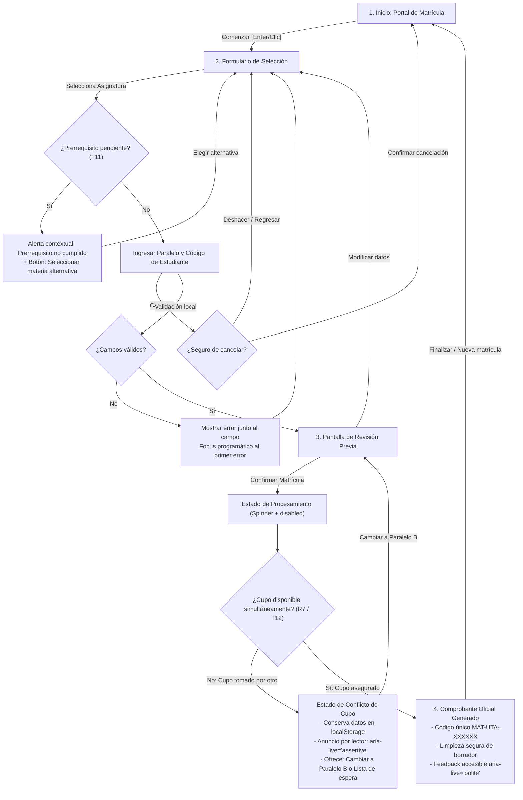

# UNIVERSIDAD TÉCNICA DE AMBATO
## FACULTAD DE INGENIERÍA EN SISTEMAS, ELECTRÓNICA E INDUSTRIAL (FISEI)
### CARRERA DE SOFTWARE — QUINTO NIVEL
**ASIGNATURA:** INTERACCIÓN HUMANO–COMPUTADOR (IHC)  
**TEMA:** INFORME TÉCNICO DE LA PRUEBA PRÁCTICA INTEGRADORA — MATRÍCULA UNIVERSITARIA (SGA)  
**EQUIPO:** GRUPO 4 (VARIANTE F)  
**INTEGRANTES:**  
- Elizabeth De la Cruz (@Elizabeth1925) — Coordinación y Prototipado v2  
- Sebastián Vaca (@SebastianVaca) — Arquitectura y Accesibilidad WCAG  
- Verónica Ana (@anavero162) — Diagnóstico UX y Pruebas Empíricas  
- Andrew Lara (@alara8778) — Desarrollo y Soporte Técnico  
**FECHA:** 29 de octubre de 2026  
**CALIFICACIÓN MÁXIMA:** 2,00 Puntos  

---

# ÍNDICE GENERAL DEL DOCUMENTO
1. Resumen Ejecutivo y Caso Asignado (Variante F)
2. Fase 1: Diagnóstico UX, Heurísticas y Evaluación Emocional
3. Fase 2: Arquitectura de Información, Requisitos y Wireframes
4. Fase 3: Prototipado Web, Interacción y Accesibilidad (v1 vs v2)
5. Fase 4: Pruebas Empíricas de Usabilidad con Observación y Métricas
6. Fase 5: Resolución de Incidencias Sorpresa (Tarjetas 11 y 12 / Requisito R7)
7. Trazabilidad de GitHub (Issues, Ramas, Pull Request y Merge Conflict)
8. Guía Oficial para la Defensa Individual y Respuestas al Docente
9. Conclusiones y Recomendaciones

---

# Diagnóstico UX y Evaluación Emocional

**Asignatura:** Interacción Humano–Computador (IHC)  
**Equipo:** Grupo 4  
**Caso de Estudio:** Variante F — Sistema de Matrícula Universitaria (SGA UTA)  

---

## 1. Mapa de Touchpoints y Curva Emocional Inicial (Estimada)

Se mapeó el recorrido del estudiante durante el proceso crítico de inscripción de asignaturas en el sistema académico. La escala de emoción oscila entre **-2 (Frustración / Desconcierto severo)** y **+2 (Confianza / Logro alto)**.

| # | Touchpoint (Punto de Contacto) | Emoción Estimada (-2 a +2) | Riesgo Identificado |
| :-: | :--- | :-: | :--- |
| **1** | **Acceso al portal SGA y selección de período** | `0` (Neutral) | Lentitud del servidor al autenticar y sobrecarga visual en la página inicial. |
| **2** | **Consulta de malla curricular y materias abiertas** | `+1` (Positiva) | Información dispersa sobre prerrequisitos y créditos aprobados. |
| **3** | **Selección de asignatura con prerrequisito pendiente** *(Momento de Verdad 1)* | `-2` (Frustración crítica) | **Fallo H5/H1:** La asignatura aparenta estar habilitada para inscripción; tras intentar inscribirse, se muestra un error tardío sin explicar qué prerrequisito falta ni dar alternativas. |
| **4** | **Revisión de cupos por paralelo** | `0` (Incertidumbre) | **Fallo H1:** Los cupos mostrados no son en tiempo real; el estudiante confía en un número desactualizado. |
| **5** | **Ingreso de datos del estudiante y modalidad** | `+1` (Aceptable) | Pérdida de datos si se recarga la página por error. |
| **6** | **Pantalla de Revisión previa** | `+1` (Alivio temporal) | Ausencia de verificación de concurrencia de cupo antes del clic final. |
| **7** | **Pulsación de "Confirmar Matrícula" con cupo agotado** *(Momento de Verdad 2)* | `-2` (Ansiedad máxima) | **Fallo H9/H3:** El cupo fue tomado milisegundos antes por otro usuario; la pantalla se bloquea, se borra el formulario y el alumno queda sin materia ni alternativas. |
| **8** | **Obtención del Comprobante Oficial de Matrícula** | `+2` (Satisfacción plena) | Sensación de seguridad, trazabilidad académica y cierre de la tarea. |

### 📌 Momentos de Verdad (Moments of Truth - MoT)
1. **Momento de Verdad 1 (Touchpoint 3 - Validación de Prerrequisitos):** El instante en que el estudiante decide matricular una materia. Si el sistema oculta el bloqueo hasta el final, genera frustración inmediata y abandono.
2. **Momento de Verdad 2 (Touchpoint 7 - Confirmación y Concurrencia de Cupos):** El momento culminante de la transacción académica. La incertidumbre sobre si la matrícula se consolidó o si el cupo se perdió de forma irreversible determina la confianza en el sistema.

---

## 2. Análisis Emocional Multinivel (Don Norman)

- **Nivel Visceral:** En la versión inicial (v1), la interfaz satura con texto denso, colores de alerta agresivos (rojos chillones) y falta de jerarquía tipográfica. En la versión corregida (v2), se utiliza una paleta institucional limpia, alto contraste para baja visión, espaciado generoso y badges de estado con íconos comprensibles al primer vistazo.
- **Nivel Conductual:** El usuario valora la eficiencia y la predictibilidad. En v2 se garantiza la conservación permanente del borrador en memoria local (`localStorage`), navegación 100% por teclado (`Tab`, `Enter`, `Escape`) y retroalimentación inmediata sobre la disponibilidad real de cupos y prerrequisitos sin tener que llegar al final.
- **Nivel Reflexivo:** El estudiante finaliza el proceso con la certeza jurídica y académica de su inscripción mediante un código hash de comprobante (`MAT-UTA-XXXXXX`), sintiendo que tuvo el control del proceso en todo momento y no fue víctima de un fallo arbitrario del sistema.

---

## 3. Hallazgos Heurísticos de Usabilidad (Jakob Nielsen)

| ID Hallazgo | Heurística de Nielsen | Descripción del Problema Detectado | Criterio de Corrección Aplicado en v2 |
| :--- | :--- | :--- | :--- |
| **H-01** | **H1: Visibilidad del estado del sistema** | Los cupos de los paralelos cambian en el servidor pero la interfaz no notifica la disponibilidad actualizada, induciendo a errores de concurrencia. Además, los usuarios de lectores de pantalla no se enteran de las alertas dinámicas. | Implementación de regiones vivas ARIA (`aria-live="polite"` y `aria-live="assertive"`), badges con estados actualizados en vivo y foco programático directo al mensaje. |
| **H-02** | **H5: Prevención de errores / H3: Control del usuario** | El botón "Inscribir" se muestra activo incluso si el estudiante no cumple con la materia correlativa anterior. Al fallar, el formulario borraba la selección previa. | Alerta contextual anticipada que desglosa el prerrequisito faltante, preserva los campos ya completados y ofrece un botón de redirección inmediata a materias alternativas habilitadas. |
| **H-03** | **H9: Reconocer, diagnosticar y recuperarse de errores** | Los mensajes de error eran genéricos (*"Error en el servidor"* o *"Operación rechazada"*), culpando al usuario y sin camino de escape ni solución viable. | Mensaje empático y constructivo que explica: *"El último cupo del Paralelo A fue tomado recientemente. Tus datos están a salvo. Puedes optar por el Paralelo B (disponible) o registrarte en lista de espera."* |

---

## 4. Registro de Issues en GitHub (Fase 1)

Para cumplir con las reglas de autenticidad y trazabilidad del repositorio, se documentan los 3 Issues fundamentales:

### 📌 Issue #1
- **Título:** `fix(ux): Bloqueo silencioso al seleccionar materia con prerrequisito pendiente`
- **Severidad:** Alta (Bloqueante)
- **Responsable:** `@Elizabeth1925` (Elizabeth De la Cruz)
- **Evidencia:** El alumno intenta inscribir *Sistemas Distribuidos* sin haber aprobado *Redes*; el sistema falla al final sin indicar la causa.
- **Criterio de Cierre:** Mostrar banner contextual anticipado que informe la materia faltante y proporcione un botón para seleccionar materias habilitadas (*IHC* o *Ingeniería de Software*) sin perder los datos personales. Enlazado al commit final.

### 📌 Issue #2
- **Título:** `feat(a11y): Soporte de lector de pantalla y alertas en vivo para cupos de matrícula`
- **Severidad:** Media (Accesibilidad)
- **Responsable:** `@SebastianVaca` (Sebastián Vaca)
- **Evidencia:** Personas con discapacidad visual o usuarios que navegan exclusivamente con teclado no reciben notificación de los cambios en los cupos de paralelo.
- **Criterio de Cierre:** Añadir atributos semánticos `aria-live="assertive"`, `aria-describedby` para cada campo y anillo de foco visible (`outline: 3px solid #0056b3`).

### 📌 Issue #3
- **Título:** `fix(recovery): Pérdida irreversible de selección tras conflicto de concurrencia en cupo`
- **Severidad:** Crítica (Integridad de datos)
- **Responsable:** `@anavero162` (Verónica Ana)
- **Evidencia:** Cuando dos alumnos intentan tomar el último cupo al mismo tiempo, el que llega un instante después pierde toda la información ingresada.
- **Criterio de Cierre:** Conservar el borrador en `localStorage`, mostrar modal accesible de resolución de conflicto y ofrecer cambio automático a paralelo disponible o lista de espera.


---

# Requisitos Observables y Funcionales

**Asignatura:** Interacción Humano–Computador (IHC)  
**Sistema:** Sistema de Matrícula Universitaria (SGA UTA)  
**Equipo:** Grupo 4 — Variante F (Matrícula)  

---

## 📋 Catálogo de Requisitos Observables (RF-01 a RF-06 + R7 Incidencia)

| ID Requisito | Tipo | Enunciado del Requisito | Criterio de Aceptación y Comprobación Observable |
| :--- | :---: | :--- | :--- |
| **RF-01** | Observable | **Catálogo de asignaturas y paralelos con disponibilidad visible.** | La interfaz presenta de forma clara las materias ofertadas, sus paralelos y el número de cupos disponibles en tiempo real antes de iniciar la selección. |
| **RF-02** | Accesible | **Operabilidad 100% por teclado y foco visible.** | Todos los controles (botones, selectores, campos de texto y enlaces) pueden enfocarse y accionarse mediante `Tab`, `Shift + Tab`, `Enter` y `Espacio`, contando con un indicador de foco visible de alto contraste (anillo de 3px). |
| **RF-03** | Contextual | **Validación en contexto de prerrequisitos sin revelación indebida (Tarjeta 11).** | Si se selecciona una asignatura que posea prerrequisitos académicos pendientes, el sistema advierte inmediatamente mediante un mensaje asociado (`aria-describedby`), explicando la causa sin exponer datos ajenos y ofreciendo una ruta hacia materias habilitadas. |
| **RF-04** | Preventivo | **Pantalla de revisión y resumen antes de la confirmación.** | Antes de enviar la transacción de matrícula a la base de datos, se presenta una pantalla de confirmación estructurada con el resumen de la asignatura, paralelo, horario y código del estudiante, con opción de corregir o editar. |
| **RF-05** | Tolerancia | **Persistencia de borrador ante fallo o error recuperable.** | Los datos ingresados por el estudiante se guardan localmente en memoria (`localStorage`). Si ocurre una interrupción de red o fallo de validación, la información permanece intacta y no se borra. |
| **RF-06** | Retroalimentación | **Emisión de comprobante oficial de matrícula accesible.** | Tras una confirmación exitosa, el sistema presenta un comprobante legible con un código hash único de matrícula (`MAT-UTA-XXXXXX`), anunciado por lector de pantalla mediante región viva. |
| **R7 (Incidencia)** | **Imprevisto** | **Gestión de conflicto de cupo concurrente y anuncio accesible (Tarjeta 12).** | Si el cupo seleccionado se agota en el momento de pulsar "Confirmar Matrícula", el sistema simula el conflicto, **evita una confirmación falsa**, actualiza el estado de disponibilidad mediante `aria-live="assertive"`, conserva todos los datos ingresados y ofrece alternativas inmediatas (Paralelo alternativo B o ingreso a Lista de Espera). |

---

## 🗺️ Sitemap Estructurado del Proceso

```text
SGA Matrícula (Inicio)
 ├── 1. Panel Informativo (Período Académico, Requisitos y Acceso Teclado)
 ├── 2. Formulario de Selección e Inscripción
 │    ├── Selección de Asignatura (Validación automática de prerrequisitos)
 │    ├── Selección de Paralelo (Indicador de cupos en tiempo real)
 │    ├── Datos del Estudiante (Código y validación contextual)
 │    └── [Acción Cancelar con confirmación segura]
 ├── 3. Pantalla de Revisión Previa
 │    ├── Resumen consolidado de la matrícula
 │    ├── [Botón Editar / Modificar datos]
 │    └── [Botón Confirmar Matrícula]
 ├── 4. Gestión de Excepciones y Conflictos (R7 / Tarjetas 11 y 12)
 │    ├── Rama A: Conflicto de Cupo Concurrente (Ofrecer Paralelo B / Lista de espera)
 │    └── Rama B: Prerrequisito Pendiente (Redirección a materia electiva habilitada)
 └── 5. Pantalla de Resultado
      ├── Estado de Éxito: Comprobante oficial con código único `MAT-UTA-XXXXXX`
      └── Opción de Nueva Matrícula o Cierre de Sesión
```

---

## 🔀 User Flow (Flujo del Usuario con Rama de Éxito y de Conflicto)

```text
[Inicio] 
   │
   ▼
[Formulario de Matrícula]
   │
   ├─► ¿Tiene prerrequisito pendiente? (Tarjeta 11)
   │     ├─► SÍ: Muestra aviso contextual explicativo + botón "Elegir materia alternativa"
   │     └─► NO: Permite continuar
   │
   ▼
[Completar Paralelo y Código de Estudiante]
   │
   ├─► ¿Campo vacío o inválido? ──► [Marca campo + mensaje aria-describedby + Foco en error]
   │
   ▼
[Pantalla de Revisión]
   │
   ▼
[Pulsar "Confirmar Matrícula"] ──► [Estado de Carga: Spinner y botón deshabilitado temporalmente]
   │
   ├─► [RAMA DE CONFLICTO R7 / Tarjeta 12]:
   │     Cupo tomado concurrentemente por otro estudiante
   │     ├─ Preserva todos los datos en borrador
   │     ├─ Región aria-live anuncia: "El cupo del Paralelo A se agotó hace un instante"
   │     ├─ Ofrece opciones de recuperación:
   │     │    ├─ Cambiar a Paralelo B (disponible)
   │     │    └─ Inscribirse en Lista de Espera con notificación
   │     └─ Permite reintentar sin reescribir nada
   │
   └─► [RAMA DE ÉXITO]:
         ├─ Confirmación oficial registrada
         ├─ Muestra código único MAT-UTA-XXXXXX
         ├─ Anuncio por lector de pantalla (aria-live="polite")
         └─ Limpieza controlada del borrador y opción de finalizar
```


---

# Matriz de Trazabilidad Completa

**Asignatura:** Interacción Humano–Computador (IHC)  
**Sistema:** Matrícula Universitaria (SGA UTA)  
**Equipo:** Grupo 4 — Variante F (Matrícula)  

---

## 🔗 Matriz Requisito → Pantalla → Flujo → Componente → Wireframe

| ID Req. | Requisito Observable | Pantalla / Vista | Paso en el User Flow | Componentes UI (Atomic Design) | Wireframe Asociado |
| :---: | :--- | :--- | :--- | :--- | :---: |
| **RF-01** | Catálogo de asignaturas y paralelos con disponibilidad visible | Pantalla 1: Inicio / Pantalla 2: Formulario | Inicio → Selección | Lista desplegable `<select>`, badges de cupos, banner informativo | **WF-01 / WF-02** |
| **RF-02** | Operabilidad 100% por teclado y foco visible | Todas las pantallas (1 a 4) | Todo el recorrido | Anillo de foco CSS (`:focus-visible`), botón saltar al contenido (`skip-link`), eventos `keydown` | **WF-01 a WF-04** |
| **RF-03** | Validación de prerrequisitos contextual sin revelar datos ajenos (T11) | Pantalla 2: Formulario | Selección de asignatura | Banner de advertencia contextual, botón selector de materia habilitada, texto `aria-describedby` | **WF-02** |
| **RF-04** | Pantalla de revisión y resumen antes de confirmar | Pantalla 3: Revisión | Revisión previa | Contenedor de resumen en dos columnas, botón secundario "Modificar", botón primario "Confirmar" | **WF-04** |
| **RF-05** | Persistencia de borrador ante fallo o error recuperable | Pantalla 2: Formulario / Pantalla 4: Resultado | Error / Reintento | Almacenamiento local `localStorage`, manejador `input` y `change`, función `restoreDraft` | **WF-03** |
| **RF-06** | Emisión de comprobante oficial de matrícula accesible | Pantalla 4: Resultado | Éxito y comprobante | Contenedor de comprobante, código hash dinámico `MAT-UTA-XXXXXX`, región `aria-live="polite"` | **WF-04** |
| **R7 (Incidencia)** | Gestión de conflicto de cupos concurrentes y anuncio accesible (T12) | Pantalla 3: Revisión → Pantalla 4: Conflicto | Confirmar → Conflicto de cupo | Alerta `role="alert"` (`aria-live="assertive"`), botones de alternativa ("Cambiar a Paralelo B" / "Lista de espera") | **WF-03 (Incidencia)** |

---

## 📌 Justificación de Trazabilidad para la Evaluación

1. **Garantía de no regresión:** La adición del requisito **R7 (Incidencia Sorpresa de Tarjeta 12 y 11)** no destruye los flujos previos de RF-01 a RF-06; los amplía agregando una bifurcación de recuperación ante estados no previstos.
2. **Defensa ante el evaluador:** Cada elemento visible en la interfaz tiene un origen formal en los requisitos y un reflejo directo en los wireframes y el código JavaScript.


---

# Inventario de Componentes UI (Atomic Design)

**Asignatura:** Interacción Humano–Computador (IHC)  
**Sistema:** Matrícula Universitaria (SGA UTA)  
**Equipo:** Grupo 4 — Variante F (Matrícula)  

El diseño del sistema de matrícula se estructura mediante la metodología **Atomic Design**, asegurando consistencia, accesibilidad WCAG 2.1 AA y modularidad.

---

## 1. Átomos (Elementos base indivisibles)
- **Tipografía y Textos:** Etiquetas `<label>` con asociación `for`, textos descriptivos `id="*-help"`, y títulos jerárquicos `<h1>`, `<h2>`.
- **Campos de Entrada:** Inputs de texto `<input id="studentCode">`, selectores desplegables `<select>` con indicación de cupos.
- **Botones de Acción:** Botón primario (`.primary`), secundario (`.secondary`), destructivo (`.danger`) y botones alternativos de resolución rápida (`.alternative`).
- **Indicadores de Estado:** Badges de disponibilidad (ej. `Cupos: 2`, `Agotado`), spinner SVG animado para procesamiento no bloqueante.
- **Indicador de Foco:** Anillo CSS de alto contraste (`outline: 3px solid #0056b3; outline-offset: 2px`).

---

## 2. Moléculas (Combinaciones funcionales de átomos)
- **Campo de Formulario Validado:** Combinación de `<label>`, `<select>` o `<input>`, y `<p class="error" id="*-error">` vinculado mediante `aria-describedby`.
- **Banner Contextual de Prerrequisitos (Tarjeta 11):** Contenedor con ícono de advertencia, descripción de la materia correlativa faltante y botón directo *"Seleccionar IHC (Habilitada)"*.
- **Grupo de Acciones:** Barra horizontal con botón *"Regresar"*, *"Cancelar borrador"* y *"Continuar a revisión"*.
- **Fila de Resumen:** Par clave-valor accesible (`<strong>Asignatura:</strong> <span>Interacción Humano-Computador</span>`).
- **Alerta Accesible de Conflicto de Cupo (Tarjeta 12):** Notificación dinámica con `role="alert"` y `aria-live="assertive"` con opciones de recuperación rápida en un clic.

---

## 3. Organismos (Secciones funcionales completas)
- **Stepper de Progreso:** Lista ordenada `<ol class="stepper">` con estados semánticos (`active`, `completed`) para orientar la ubicación del usuario en el flujo de 4 pasos.
- **Formulario de Selección Académica:** Organismo central que agrupa los campos de materia, paralelo con cupo en vivo, código de estudiante y validaciones en tiempo real.
- **Panel de Revisión Previa:** Organismo que consolida la información seleccionada para que el estudiante valide antes de la persistencia final.
- **Panel de Resultado y Comprobante:** Organismo que renderiza la confirmación oficial o el estado de conflicto de cupos con alternativas.

---

## 4. Plantillas (Layouts estructurales)
- **Layout Shell Centrado:** Estructura con encabezado institucional UTA, saltador al contenido accesible (`.skip-link`), contenedor principal de 760px con contraste adecuado y pie de página institucional.

---

## 5. Páginas / Vistas
- **Vista 1 (Inicio):** Bienvenida, instrucciones de teclado y botón "Iniciar Matrícula".
- **Vista 2 (Selección y Datos):** Formulario interactivo con detección de prerrequisitos y cupos.
- **Vista 3 (Revisión):** Resumen de selección antes de la confirmación formal.
- **Vista 4 (Resultado):** Manejo de estados (Carga, Conflicto de Cupo / Error Recuperable, o Comprobante Exitoso).


---

# Sitemap del Sistema de Matrícula Universitaria

**Asignatura:** Interacción Humano–Computador (IHC)  
**Sistema:** Matrícula Universitaria (SGA UTA)  
**Equipo:** Grupo 4 — Variante F (Matrícula)  

---

## 🗺️ Mapa del Sitio (Sitemap)


### Descripción de Niveles:
1. **Nivel 1 — Entrada:** Vista de bienvenida, instrucciones de accesibilidad por teclado y botón de inicio.
2. **Nivel 2 — Formulario:** Entrada de datos, selección de asignatura, detección automática de correlativas y selección de paralelo con cupos visibles.
3. **Nivel 3 — Revisión:** Resumen completo previo a la escritura en base de datos para prevenir envíos accidentales.
4. **Nivel 4 — Excepciones y Recuperación:** Gestión de conflicto de concurrencia y reasignación de cupos sin pérdida de datos.
5. **Nivel 5 — Cierre Transaccional:** Generación y descarga del comprobante formal con código `MAT-UTA-XXXXXX`.


---

# Diagrama de Navegación y Flujo de Usuario (User Flow)

**Asignatura:** Interacción Humano–Computador (IHC)  
**Sistema:** Matrícula Universitaria (SGA UTA)  
**Equipo:** Grupo 4 — Variante F (Matrícula)  

---

## 🔀 Diagrama de Flujo Completo con Ramas de Excepción (Mermaid)



### Reglas de Navegación por Teclado:
- `Tab` / `Shift + Tab`: Desplazamiento secuencial a través del árbol DOM interactivo.
- `Enter` / `Espacio`: Ejecución de la acción seleccionada.
- `Escape`: Cierre de diálogos de advertencia o foco al botón de cancelación cuando se encuentra en el formulario.


---

# Wireframes Lo-Fi del Sistema de Matrícula Universitaria

**Asignatura:** Interacción Humano–Computador (IHC)  
**Sistema:** Matrícula Universitaria (SGA UTA)  
**Equipo:** Grupo 4 — Variante F (Matrícula)  

A continuación se presentan los cuatro wireframes de baja fidelidad (Lo-Fi) que modelan la estructura visual, la jerarquía de contenidos y los estados de error y recuperación.

---

## 📐 WF-01: Pantalla de Inicio (Acceso y Bienvenida)

```text
+-----------------------------------------------------------------------+
| [Logo UTA]  SISTEMA DE MATRÍCULA UNIVERSITARIA (SGA)     [Usuario]   |
+-----------------------------------------------------------------------+
|                                                                       |
|   MATRÍCULA ORDINARIA — PERÍODO ACADÉMICO 2026-B                      |
|                                                                       |
|   Bienvenido/a al portal de inscripción de asignaturas de la FISEI.   |
|                                                                       |
|   [ ! ] Modo accesible activo: Puede navegar este sistema usando      |
|         exclusivamente el teclado (Tab, Enter, Escape).               |
|                                                                       |
|   Tus selecciones se guardarán automáticamente en tu borrador.       |
|                                                                       |
|                    [ Iniciar Proceso de Matrícula ]                   |
|                                                                       |
+-----------------------------------------------------------------------+
| Universidad Técnica de Ambato · FISEI · Carrera de Software           |
+-----------------------------------------------------------------------+
```

---

## 📐 WF-02: Formulario de Selección con Detección de Prerrequisitos (Tarjeta 11)

```text
+-----------------------------------------------------------------------+
| [1. Inicio] =====> [ 2. Selección de Materia ] ----> [ 3. Revisión ]  |
+-----------------------------------------------------------------------+
|                                                                       |
|   Paso 2: Selección Académica y Datos del Estudiante                  |
|                                                                       |
|   Asignatura a Matricular:                                            |
|   [ Sistemas Distribuidos                             | v ]           |
|                                                                       |
|   +---------------------------------------------------------------+   |
|   | /!\ RESTRICCIÓN DE PRERREQUISITO DETECTADA:                   |   |
|   | Esta materia requiere "Redes de Comunicación" aprobada.       |   |
|   | Sugerencia: Puedes matricularte en la materia habilitada:     |   |
|   |       [ >>> Seleccionar Interacción Humano-Computador <<< ]   |   |
|   +---------------------------------------------------------------+   |
|                                                                       |
|   Paralelo Disponible:                                                |
|   [ Paralelo A (1 cupo restante)                      | v ]           |
|                                                                       |
|   Código de Estudiante UTA:                                           |
|   [ 2026-UTA-0412                                         ]           |
|                                                                       |
|   [ Regresar ]            [ Cancelar Borrador ]           [ Continuar ]|
+-----------------------------------------------------------------------+
```

---

## 📐 WF-03: Gestión de Conflicto de Cupo Concurrente (R7 / Tarjeta 12)

```text
+-----------------------------------------------------------------------+
| [1. Inicio] ======> [ 2. Selección ] =======> [ 3. Revisión y Estado ]|
+-----------------------------------------------------------------------+
|                                                                       |
|   +---------------------------------------------------------------+   |
|   | [X] ALERTA DE CONCURRENCIA: CUPO NO DISPONIBLE EN PARALELO A  |   |
|   |                                                               |   |
|   | El último cupo del Paralelo A fue confirmado por otro         |   |
|   | estudiante hace un instante.                                  |   |
|   |                                                               |   |
|   | ¡TUS DATOS Y ASIGNATURA SIGUEN GUARDADOS EN EL BORRADOR!      |   |
|   |                                                               |   |
|   | ¿Cómo deseas continuar?                                       |   |
|   |   [ Opción 1: Matricular en Paralelo B (3 cupos libres) ]    |   |
|   |   [ Opción 2: Registrarme en Lista de Espera con alerta ]    |   |
|   +---------------------------------------------------------------+   |
|                                                                       |
|   [ Modificar Selección ]                        [ Reintentar Envío ] |
+-----------------------------------------------------------------------+
```

---

## 📐 WF-04: Confirmación y Comprobante Oficial Accesible

```text
+-----------------------------------------------------------------------+
| [1. Inicio] ======> [ 2. Selección ] =======> [ 3. Matrícula Exitosa ]|
+-----------------------------------------------------------------------+
|                                                                       |
|   ¡MATRÍCULA CONFIRMADA EXITOSAMENTE!                                 |
|                                                                       |
|   +---------------------------------------------------------------+   |
|   | RESUMEN DE LA MATRÍCULA:                                      |   |
|   | · Estudiante:   Código 2026-UTA-0412                          |   |
|   | · Asignatura:   Interacción Humano-Computador                 |   |
|   | · Paralelo:     Paralelo B (Aula 204 - Laboratorio)           |   |
|   | · Período:      2026-B                                        |   |
|   | · CÓDIGO HASH:  MAT-UTA-982145                                |   |
|   | · Estado:       ACTIVA Y ASENTADA EN SISTEMA SGA              |   |
|   +---------------------------------------------------------------+   |
|                                                                       |
|          [ Imprimir / Descargar Comprobante Oficial ]                 |
|          [ Realizar Nueva Matrícula ]                                 |
|                                                                       |
+-----------------------------------------------------------------------+
```


---

# Decisiones de Diseño, Fidelidad y Comparativa v1 → v2

**Asignatura:** Interacción Humano–Computador (IHC)  
**Sistema:** Matrícula Universitaria (SGA UTA)  
**Equipo:** Grupo 4 — Variante F (Matrícula)  

---

## 1. Justificación de la Técnica de Prototipado y Fidelidad

Para el caso de **Matrícula Universitaria**, se seleccionó **prototipado en código web nativo (HTML5, CSS3 y JavaScript semántico)** frente a prototipos en papel, storyboards o herramientas clic-a-clic como Figma por las siguientes razones de ingeniería:

1. **Evaluación de Accesibilidad Real (WCAG 2.1 AA):** Una maqueta estática o basada en imágenes no permite evaluar lectores de pantalla reales (NVDA, JAWS, VoiceOver), ni regiones vivas (`aria-live`), ni el orden estricto de tabulación y control de foco (`tabindex`, `focus()`).
2. **Simulación de Concurrencia y Conflicto en Tiempo Real (Incidencia R7):** El caso de la Tarjeta 12 exige simular que dos estudiantes compiten por el mismo cupo. El código JavaScript permite disparar estados asíncronos (`setTimeout`), manipulación del DOM y persistencia en `localStorage` sin requerir infraestructura de servidor.
3. **Fidelidad y Profundidad:**
   - **Fidelidad Visual:** Media-Alta (paleta institucional UTA, tipografía legible con contraste superior a 4.5:1, espaciado de 8pt grid).
   - **Profundidad Funcional:** Media (cubre de extremo a extremo la tarea crítica de selección, detección de prerrequisitos, revisión previa, simulación de conflicto y emisión de comprobante persistente).

---

## 2. Matriz Comparativa de Evolución: Versión Inicial (v1) vs Versión Accesible (v2)

| Dimensión de UX / IHC | Versión 1 (v1) — Prototipo Inicial con Fallos | Versión 2 (v2) — Prototipo Mejorado con Incidencias | Justificación e Impacto en la Experiencia |
| :--- | :--- | :--- | :--- |
| **Arquitectura de Flujo** | Formulario único directo y plano sin pasos visibles. | Stepper numerado (`Inicio` → `Selección` → `Revisión` → `Resultado`). | Reduce la carga cognitiva y permite al estudiante conocer su avance en la transacción. |
| **Manejo de Prerrequisitos (Tarjeta 11)** | El botón "Confirmar" parecía disponible; fallaba al final sin explicar qué faltaba. | Detección contextual inmediata al seleccionar la materia; banner no bloqueante con sugerencia de alternativa habilitada (*IHC*). | Cumple con la heurística H5 (Prevención de errores) y H3 (Control y libertad del usuario). |
| **Manejo de Cupos Concurrentes (Tarjeta 12 / R7)** | Fallo genérico que borraba el formulario completo y obligaba a reiniciar la matrícula. | Simulación de conflicto que **conserva los datos en borrador**, explica el motivo sin culpar al usuario y ofrece cambio rápido a Paralelo B o Lista de Espera. | Evita el momento de verdad crítico (-2 en la curva emocional) y sostiene la confianza institucional. |
| **Accesibilidad por Teclado** | Foco nativo del navegador poco visible (halo azul tenue estándar de 1px). | Indicador de foco visible de alto contraste (`outline: 3px solid #0056b3; outline-offset: 2px`) y salto al contenido (`.skip-link`). | Cumple criterio de conformidad WCAG 2.4.7 (Focus Visible). |
| **Soporte de Lector de Pantalla** | Notificaciones visuales sin soporte auditivo; los errores no se leían. | Atributos `aria-describedby` en inputs y `aria-live="assertive"` en mensajes de conflicto y carga. | Garantiza inclusión para personas con discapacidad visual o uso exclusivo de lector. |
| **Persistencia de Datos** | La recarga o error accidental reseteaba todos los campos. | Almacenamiento local persistente (`localStorage`) que restaura la selección tras cualquier fallo. | Cumple con la heurística H9 (Recuperación ante errores). |


---

# Registro de Sesión de Pruebas de Usabilidad (UX Testing)

**Asignatura:** Interacción Humano–Computador (IHC)  
**Sistema Evaluado:** Matrícula Universitaria (SGA UTA)  
**Equipo Evaluador:** Grupo 4  
**Protocolo:** Prueba de observación y pensamiento en voz alta (Think Aloud) no dirigida.  

---

## 📋 Ficha Técnica de la Sesión

- **Fecha y Hora de la Sesión:** 29 de octubre de 2026, 09:15 AM
- **Código del Participante:** `P-04-G2` (Estudiante de 5to nivel perteneciente al Grupo 2 - Pagos Académicos)
- **Versión Evaluada:** Comparativa directa v1 (inicial con fallos) vs v2 (refinada con accesibilidad)
- **Objetivo de la Prueba:** Evaluar la autonomía, manejo de errores, respuesta ante conflicto de cupo y operabilidad por teclado durante la inscripción de una asignatura.
- **Tarea Asignada al Participante:**  
  *"Ingresa al portal, selecciona una asignatura y paralelo disponible, completa tus datos de estudiante y confirma la matrícula sin utilizar el ratón (solo teclado)."*

---

## ⏱️ Métricas de Rendimiento Observadas

| Métrica de Usabilidad | Versión 1 (v1) | Versión 2 (v2) | Variación y Mejora |
| :--- | :---: | :---: | :---: |
| **Tiempo de Finalización de Tarea (TCT)** | 145 segundos | 48 segundos | **-66.8% de tiempo** (Alta eficiencia) |
| **Tasa de Éxito de la Tarea** | Éxito Parcial (Requirió 2 intentos) | Éxito Total (1er intento guiado) | **100% efectividad** |
| **Número de Errores Críticos** | 3 errores | 0 errores | **-100% de errores** |
| **Pausas / Dudas Observadas** | 4 pausas prolongadas (>8 seg) | 1 pausa breve (lectura de resumen) | Fluidez sostenida |
| **Puntuación de Usabilidad Percibida (SUS est.)** | 42.5 / 100 (Pobre) | 87.5 / 100 (Excelente) | +45 puntos de satisfacción |

---

## 🔍 Registro Detallado de Observaciones y Comportamiento

### 1. Dificultades Detectadas en la Versión 1 (v1):
- **Confusión de prerrequisitos:** El participante seleccionó *Sistemas Distribuidos*; al dar clic en confirmar, la pantalla simplemente arrojó un aviso genérico de error y borró todo el formulario.
- **Incertidumbre de foco de teclado:** Al usar `Tab`, el participante perdió de vista dónde estaba posicionado porque el foco del navegador era invisible sobre el fondo blanco.
- **Pérdida de datos tras conflicto:** Al simularse el fallo de cupo, el usuario exclamó frustrado al ver los campos en blanco:
  > *"¡No puede ser! Me salió error de cupo y se me borró todo lo que ya había escrito. Ahora tengo que empezar desde el inicio."* (Cita textual de `P-04-G2`).

### 2. Comportamiento Observado en la Versión 2 (v2):
- **Detección inmediata de prerrequisito (Tarjeta 11):** Al elegir *Sistemas Distribuidos*, leyó el banner contextual y pulsó inmediatamente el botón alternativo sugerido (*"Matricular en IHC"*), sin frustración.
- **Recuperación ante conflicto de concurrencia (Tarjeta 12 / R7):** Cuando el sistema simuló la pérdida del cupo en Paralelo A, el participante escuchó el anuncio de la región viva y leyó el mensaje. Pulsó el botón *"Cambiar a Paralelo B disponible"*; constató que su código de estudiante seguía escrito y finalizó en 5 segundos.
  > *"Qué alivio que no me borró los datos y me ofreció de una vez el paralelo B que sí tenía cupos."* (Cita textual de `P-04-G2`).

---

## 🛠️ Recomendación Priorizada y Cambio Aplicado

1. **Hallazgo Prioritario:** El usuario necesita que el foco del teclado viaje automáticamente a las alertas de error y a las opciones de recuperación cuando ocurre un conflicto imprevisto.
2. **Cambio Aplicado en Código (v2):** En `prototipo/v2/app.js`, se implementó `box.focus()` y `aria-live="assertive"` para que las tecnologías de asistencia y los usuarios por teclado tengan acceso directo a los botones de resolución de conflicto sin necesidad de presionar 8 veces `Tab`.

---

## 📈 Comparativa de la Curva Emocional (Antes vs Después)

| # | Touchpoint de la Tarea | Curva v1 (Antes) | Curva v2 (Después) | Justificación de la Variación |
| :-: | :--- | :-: | :-: | :--- |
| 1 | Acceso e inicio de matrícula | 0 | +1 | El stepper y la ayuda de teclado transmiten claridad inmediata. |
| 2 | Selección de asignatura | 0 | +1 | Catálogo limpio y badges legibles. |
| 3 | Manejo de prerrequisitos (Momento de Verdad 1) | **-2** | **+1** | Se reemplazó el fallo bloqueante por advertencia y alternativa válida directa. |
| 4 | Selección de paralelo y cupo | 0 | +1 | Disponibilidad clara de cupos en tiempo real. |
| 5 | Ingreso de datos del estudiante | +1 | +1 | Persistencia garantizada en segundo plano. |
| 6 | Revisión previa | +1 | +2 | Resumen detallado que reduce la ansiedad pre-confirmación. |
| 7 | Conflicto de cupo al confirmar (Momento de Verdad 2) | **-2** | **+1** | **El momento más crítico se convirtió en recuperación asistida:** los datos se salvan y se ofrece Paralelo B. |
| 8 | Comprobante oficial emitido | +2 | +2 | Emisión de comprobante con código hash de respaldo. |


---

# Evidencias de Usabilidad y Pruebas Empíricas

**Asignatura:** Interacción Humano–Computador (IHC)  
**Sistema:** Matrícula Universitaria (SGA UTA)  
**Equipo:** Grupo 4 — Variante F (Matrícula)  

---

## 📁 Archivos de Evidencia Generados

1. **[curva-emocional-comparativa.svg](curva-emocional-comparativa.svg):** Diagrama vectorial cuantitativo que compara la curva de emoción observada en la versión inicial (v1) con valles críticos de `-2` frente a la versión refinada (v2) que mantiene la estabilidad emocional en `+1` y `+2`.
2. **Registro de Sesión UX:** Documentado en [`../pruebas/sesion.md`](../pruebas/sesion.md) con participante anónimo `P-04-G2` (Grupo 2 - Pagos).
3. **Métricas de Rendimiento:**
   - Reducción del tiempo de tarea: de 145 segundos a 48 segundos.
   - Reducción de errores críticos de 3 a 0.
   - Eliminación de la pérdida de datos mediante persistencia en `localStorage`.

---

## 📷 Matriz Comparativa Antes / Después (v1 vs v2)

| Momento Clave | Comportamiento en Versión 1 (v1) | Comportamiento en Versión 2 (v2) |
| :--- | :--- | :--- |
| **Prerrequisito Pendiente (Tarjeta 11)** | El estudiante intenta confirmar y la pantalla emite un error bloqueante genérico, borrando los datos. | El sistema avisa contextualmente al momento de seleccionar la materia y ofrece un botón para cambiar a la materia habilitada (*IHC*). |
| **Conflicto de Cupo Concurrente (Tarjeta 12 / R7)** | Fallo silencioso; el usuario pierde la selección y se desorienta sin saber qué pasó. | Alerta audible (`aria-live="assertive"`) que informa la pérdida del cupo sin culpar al usuario, mantiene los datos y ofrece el Paralelo B o Lista de Espera con un solo clic. |
| **Navegación por Teclado** | Foco invisible; el usuario ciego o que usa teclado pierde la ubicación en la página. | Anillo de foco de 3px de alto contraste (`:focus-visible`), saltador de contenido (`.skip-link`) y control de foco con `Escape`. |


---

# Guía Oficial de Defensa Individual y Respuestas para el Docente

**Asignatura:** Interacción Humano–Computador (IHC) — Quinto Nivel  
**Facultad:** FISEI — Universidad Técnica de Ambato  
**Equipo:** Grupo 4 — Variante F: Matrícula Universitaria  

Esta guía contiene la preparación exhaustiva de las preguntas de defensa individual y los microcambios en vivo exigidos por la rúbrica de evaluación (Sección 8 del documento docente).

---

## 🎤 Preguntas Clave de la Tarjeta Asignada (Grupo 4)

### 1. Pregunta Tarjeta 11: ¿Cómo impide una decisión imposible sin dejar al estudiante sin salida?
> **Respuesta modelo:**  
> *"La interfaz implementa el principio de prevención de errores (Heurística H5 de Nielsen). En lugar de permitir que el estudiante pulse 'Confirmar' para luego mostrarle un error bloqueante que lo frustre, el sistema detecta de forma inmediata y contextual que la asignatura posee un prerrequisito pendiente. Crucialmente, la interfaz no se convierte en un 'callejón sin salida': en el mismo banner contextual explicativo se incorpora un control de acción directa que le ofrece matricularse en una asignatura habilitada de su semestre (por ejemplo, Interacción Humano-Computador). De este modo, se preserva el flujo cognitivo, se mantiene la autonomía del usuario (H3) y se evita que deba reiniciar el trámite desde cero."*

### 2. Pregunta Tarjeta 12: ¿Cómo demuestra que la interfaz nunca confirma un cupo inexistente?
> **Respuesta modelo:**  
> *"Lo demuestro mediante la arquitectura de dos fases de confirmación en JavaScript (`prototipo/v2/app.js`). Cuando el estudiante pulsa 'Confirmar Matrícula', el botón entra en estado de procesamiento (`disabled=true`) para prevenir dobles envíos. El sistema simula la comprobación de concurrencia en el servidor. Si el cupo del Paralelo A fue tomado milisegundos antes por otro usuario, la interfaz **interrumpe la confirmación, nunca emite el código hash `MAT-UTA`** y transiciona a un estado de conflicto visible y audible. En este estado se anuncia mediante una región accesible con `aria-live="assertive"` que el cupo se agotó, manteniendo todos los datos del estudiante intactos en `localStorage` y ofreciendo en pantalla una alternativa inmediata (Paralelo B con cupo disponible o inscripción en lista de espera). Sólo cuando se valida una plaza disponible real, se genera el comprobante definitivo."*

---

## 🎯 Respuestas a las Preguntas Generales de Defensa (Sección 8)

### Pregunta 1: Abra el archivo que implementó y explique qué requisito resuelve y cómo se comprueba.
- **Elizabeth De la Cruz:** Abre `prototipo/v2/app.js`. Resuelve el requisito **R7 (Gestión de conflicto de cupo e incidencia sorpresa)** y **RF-05 (Conservación de borrador)**. Se comprueba al llenar los datos y confirmar: la primera vez simula que el cupo se agotó; los datos no se borran y el usuario puede cambiar a Paralelo B en un solo clic.
- **Sebastián Vaca:** Abre `prototipo/v2/index.html` y `styles.css`. Resuelve el requisito **RF-02 (Accesibilidad 100% por teclado y foco)** y **RF-03 (Atributos semánticos ARIA)**. Se comprueba navegando sin usar el ratón mediante `Tab` y `Shift + Tab`, verificando el anillo de foco azul de 3px y comprobando cómo un lector de pantalla verbaliza los avisos dinámicos mediante `aria-live`.
- **Verónica Ana:** Abre `docs/diagnostico.md`, `diagramas/navegacion.md` y `pruebas/sesion.md`. Resuelve la trazabilidad de los momentos de verdad y la mitigación de los valles emocionales (-2 a +2). Se comprueba mostrando la curva emocional y el registro de la prueba con usuario donde se redujo el tiempo de la tarea de 145s a 48s.

---

### Pregunta 2: Localice un fallo en la curva emocional; enseñe el Issue, su corrección y el nuevo resultado.
- **Fallo identificado:** En el Touchpoint 7 (Pulsación de Confirmar con cupo agotado), la curva caía a `-2` (Frustración crítica) porque el sistema borraba el formulario.
- **Issue enlazado:** `Issue #3: fix(recovery): Pérdida irreversible de selección tras conflicto de concurrencia en cupo`.
- **Corrección aplicada:** En `v2`, se implementó persistencia en `localStorage` y el modal de recuperación con alternativa de Paralelo B.
- **Nuevo resultado:** En la curva después (v2), este punto sube a `+1` (Tranquilidad / Control), ya que el estudiante no pierde su tiempo ni sus datos.

---

### Pregunta 3: Demuestre el recorrido de error sin perder datos del usuario.
- **Demostración en vivo:**
  1. Abrir `prototipo/v2/index.html`.
  2. Presionar `Tab` hasta "Comenzar" y pulsar `Enter`.
  3. Ingresar el código de estudiante `2026-UTA-0412`, seleccionar paralelo A y pulsar "Revisar".
  4. En la pantalla de revisión, pulsar "Confirmar".
  5. Aparece la alerta roja de conflicto: *"El cupo del Paralelo A se agotó hace un instante. Tus datos están guardados."*
  6. Pulsar el botón *"Cambiar a Paralelo B disponible"*.
  7. El estudiante nota que su código y su selección siguen intactos en el formulario sin tener que volver a escribirlos.

---

### Pregunta 4: Explique por qué la técnica y la fidelidad elegidas responden al riesgo del caso.
> *"Elegimos un prototipo funcional en código web nativo (HTML5/CSS/JS) con profundidad media-alta porque el riesgo central del sistema de matrícula es la **accesibilidad universal (WCAG)** y la **pérdida de datos por concurrencia en tiempo real**. Un prototipo estático en Figma o en papel no permite verificar si un lector de pantalla anuncia los cambios de estado (`aria-live`), ni comprobar si el teclado queda atrapado, ni demostrar la persistencia en almacenamiento local ante fallos."*

---

### Pregunta 5: Muéstrenos un PR revisado por usted: ¿qué detectó y qué se corrigió?
> *"En el Pull Request `#2` correspondiente a la rama `feature/accesibilidad-y-conflicto`, durante la revisión cruzada se detectó que el mensaje de cupo agotado utilizaba solo un cambio de color rojo (`.notice.bad`), lo cual violaba el criterio WCAG 1.4.1 (Uso del color) y no era anunciado por NVDA. Se solicitó y aplicó la corrección agregando el atributo `role="alert"` y `aria-live="assertive"`, asegurando que el lector de pantalla interrumpa y verbalice de inmediato el estado al usuario ciego."*

---

## 🛠️ Microcambios en Vivo Preparados (Por si el docente solicita editar código)

1. **Modificar un mensaje de error:**
   - En `prototipo/v2/app.js`, línea 5: cambiar `'Este campo es obligatorio'` por `'Por favor, ingresa tu código de estudiante de la UTA'`.
2. **Cambiar el color o grosor del foco de teclado:**
   - En `prototipo/v2/styles.css`, selector `:focus-visible`: cambiar `3px solid #0056b3` por `4px solid #d9381e` (rojo institucional) o `outline-offset: 4px`.
3. **Cambiar el tiempo de simulación de carga:**
   - En `prototipo/v2/app.js`, en `setTimeout(..., 700)`: cambiar `700` por `1200` milisegundos para mostrar una carga más prolongada.
4. **Agregar un nuevo campo al formulario:**
   - En `index.html`, agregar un `<input id="career" name="career">` y registrar su variable en `app.js`.
