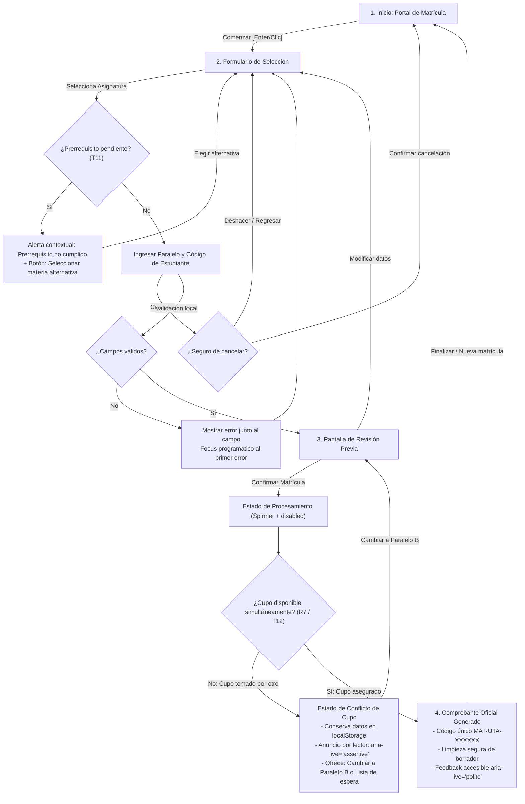

# Diagrama de Navegación y Flujo de Usuario (User Flow)

**Asignatura:** Interacción Humano–Computador (IHC)  
**Sistema:** Matrícula Universitaria (SGA UTA)  
**Equipo:** Grupo 4 — Variante F (Matrícula)  

---

## 🔀 Diagrama de Flujo Completo con Ramas de Excepción (Mermaid)

### Reglas de Navegación por Teclado:
- `Tab` / `Shift + Tab`: Desplazamiento secuencial a través del árbol DOM interactivo.
- `Enter` / `Espacio`: Ejecución de la acción seleccionada.
- `Escape`: Cierre de diálogos de advertencia o foco al botón de cancelación cuando se encuentra en el formulario.
