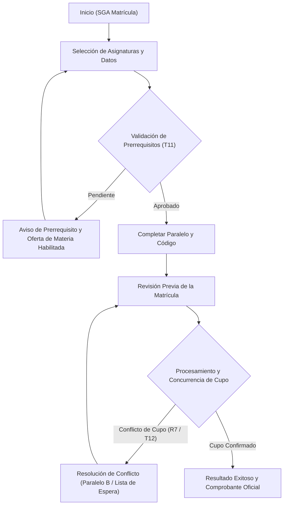

# Sitemap del Sistema de Matrícula Universitaria

**Asignatura:** Interacción Humano–Computador (IHC)  
**Sistema:** Matrícula Universitaria (SGA UTA)  
**Equipo:** Grupo 4 — Variante F (Matrícula)  

---

## 🗺️ Mapa del Sitio (Sitemap)

### Descripción de Niveles:
1. **Nivel 1 — Entrada:** Vista de bienvenida, instrucciones de accesibilidad por teclado y botón de inicio.
2. **Nivel 2 — Formulario:** Entrada de datos, selección de asignatura, detección automática de correlativas y selección de paralelo con cupos visibles.
3. **Nivel 3 — Revisión:** Resumen completo previo a la escritura en base de datos para prevenir envíos accidentales.
4. **Nivel 4 — Excepciones y Recuperación:** Gestión de conflicto de concurrencia y reasignación de cupos sin pérdida de datos.
5. **Nivel 5 — Cierre Transaccional:** Generación y descarga del comprobante formal con código `MAT-UTA-XXXXXX`.
